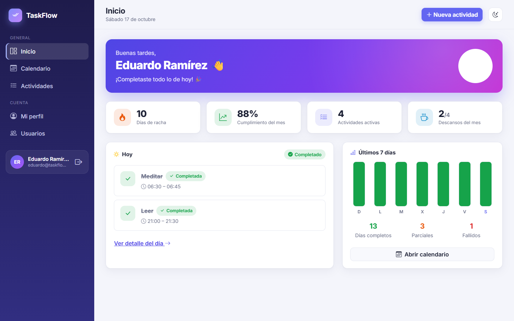
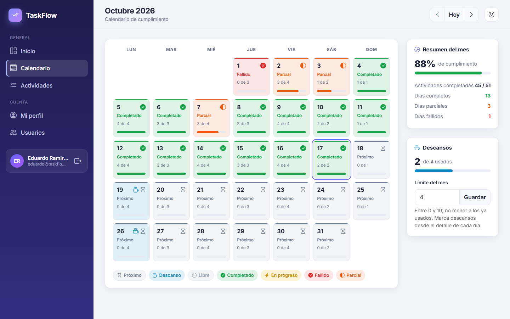
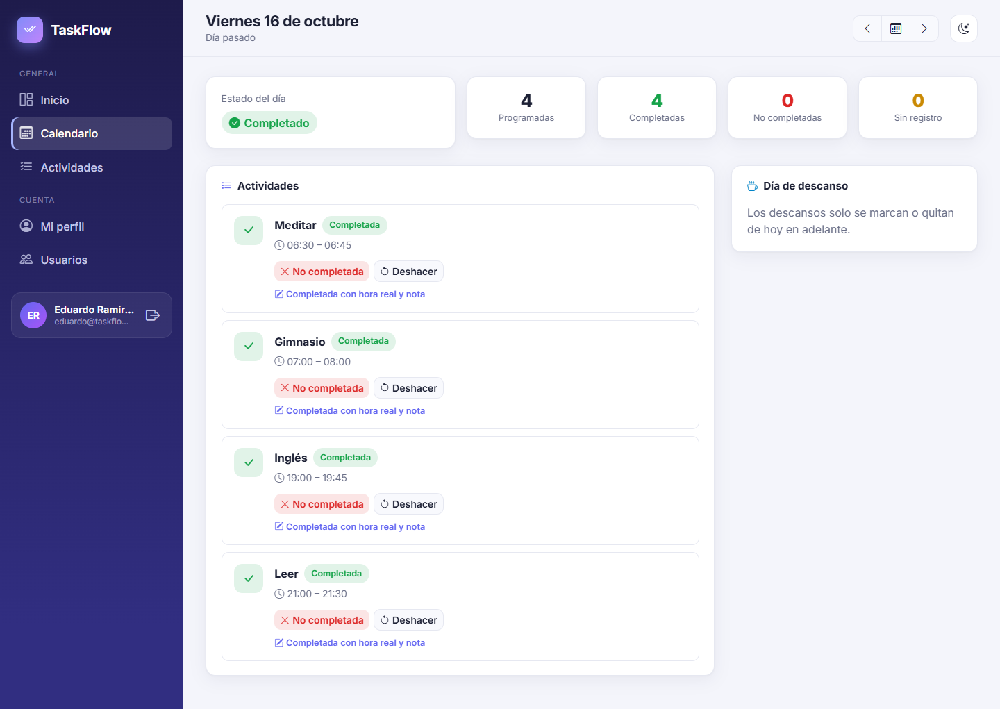
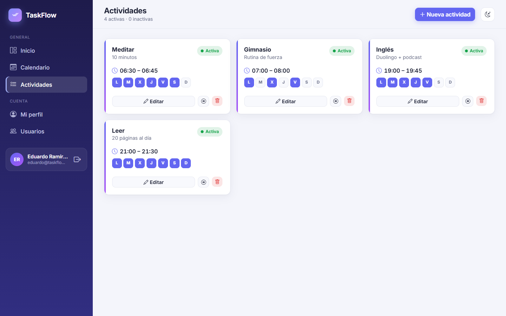
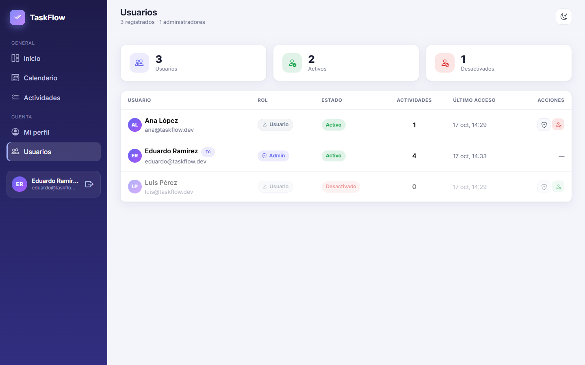
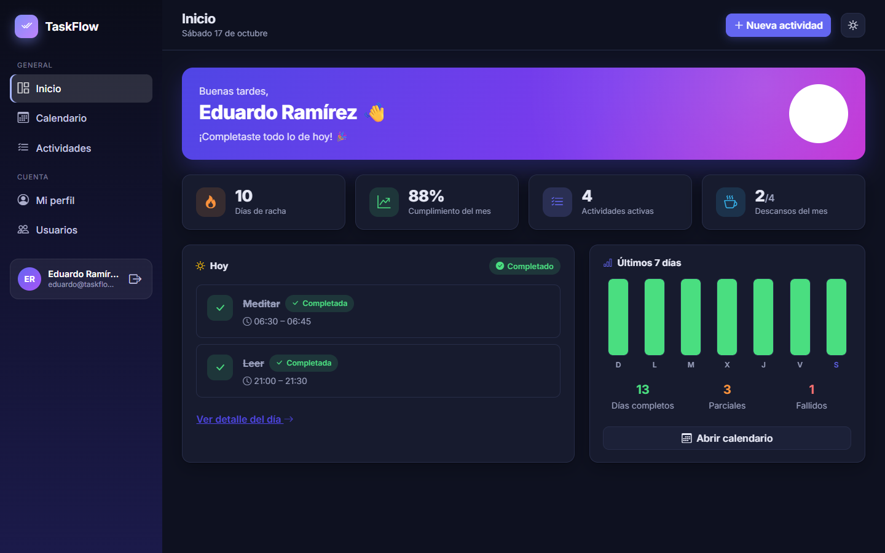
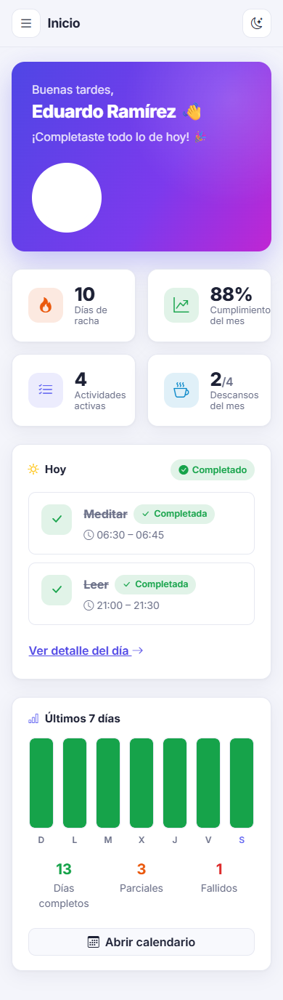
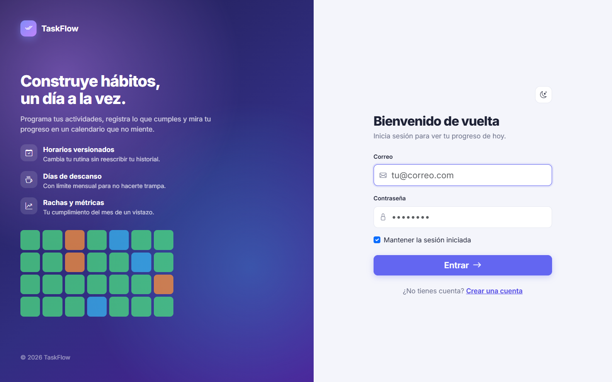

# TaskFlow.Web

[](https://github.com/edu-tech220/TaskFlow.Web/actions/workflows/ci.yml)


Web client for **TaskFlow**, a daily habit tracker, built with **ASP.NET Core MVC** (Razor +
Bootstrap 5.3). It is an independent application: it shares no code with the backend and talks to
the REST API only over HTTP.

**Backend API:** [edu-tech220/TaskFlow](https://github.com/edu-tech220/TaskFlow)



> The user interface is in Spanish (es-MX); code and documentation are in English.

## Features

- **Sign in / sign up.** The first user registered in the API becomes the administrator.
- **Dashboard:** today's progress, completion streak, monthly completion rate, today's activities
  with one-click actions and a last-7-days chart.
- **Monthly calendar:** one color per day status, per-day progress, rest days and monthly summary.
- **Day detail:** mark activities as completed or not completed, optional actual end time and note,
  undo a record, mark or remove a rest day.
- **Activities:** create and edit with a day picker, versioned schedule changes with history,
  deactivate/reactivate and delete.
- **Profile:** change display name and password.
- **Users (admins only):** promote/demote administrators and deactivate accounts.
- **Responsive layout** with a sidebar (off-canvas on mobile) and **light/dark mode**.

The backend only returns statuses; colors and labels are decided here.

## How the session works

1. Login sends email and password to `POST /api/auth/login` and receives a **JWT**.
2. The app issues its own **session cookie** (`HttpOnly`, `SameSite=Lax`, encrypted with Data
   Protection) and stores the JWT **inside** it. The browser never sees the token.
3. `BearerTokenHandler` (an `HttpClient` `DelegatingHandler`) adds `Authorization: Bearer <token>`
   to every API call.
4. If the API returns **401** (expired token or deactivated user), `ApiSessionFilter` signs the user
   out and redirects to the login page with a message.
5. The cookie expires at the same time as the JWT.

Every page requires a session (global `AuthorizeFilter`) except login and registration. The users
section requires the `Admin` role, and the API checks it again.

## Getting started

Requirements: .NET SDK 10 and the [TaskFlow API](https://github.com/edu-tech220/TaskFlow) running
(by default at `https://localhost:7256`, the API's `https` profile).

```powershell
cd TaskFlow.Web
dotnet run --launch-profile https   # https://localhost:7100
```

The API base URL is configured in `TaskFlow.Web/appsettings.json`:

```json
"TaskFlowApi": { "BaseUrl": "https://localhost:7256" }
```

It can be overridden with the `TaskFlowApi__BaseUrl` environment variable (for example, use the IIS
Express port if you run the API that way).

## Design notes

- **Post/Redirect/Get:** every form ends in a redirect and the result is shown through TempData, so
  reloading the page never resubmits a form.
- **Global antiforgery validation:** every POST requires the token added by the `<form>` tag helpers.
- **Two-layer validation:** forms validate for quick feedback, but the API is the source of truth and
  its errors (400/401/409) are shown as returned.
- **No front-end build step:** Bootstrap lives in `wwwroot/lib`; the Inter font and Bootstrap Icons
  are loaded from a CDN.

## Project structure

```
TaskFlow.Web/
  Controllers/   HomeController (dashboard), CalendarController (calendar, day, records, rest days),
                 ActivitiesController, AccountController (login, register, profile), AdminController (users)
  Models/        ApiModels.cs: copy of the API JSON contract
                 ViewModels.cs: forms, dashboard metrics, labels and colors
  Services/      TaskFlowApiClient (typed HttpClient), BearerTokenHandler, ApiSessionFilter
  Views/         Razor; Shared/_Layout (sidebar) and Shared/_AuthLayout (login/register)
  wwwroot/css/   site.css: design tokens (light/dark), statuses, calendar, cards
  wwwroot/js/    site.js: theme toggle and confirmations
```

## Screenshots

| Calendar | Day detail |
|---|---|
|  |  |

| Activities | Users (admin) |
|---|---|
|  |  |

| Dark mode | Mobile | Login |
|---|---|---|
|  |  |  |

## License

[MIT](LICENSE)
